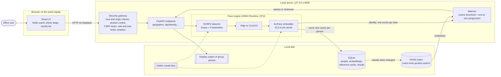

# Architecture

One process on one laptop. The browser UI and the API are served from the same
local address, the face models run on the CPU, and all data stays in a local
folder. Nothing is sent anywhere.

## Diagram

> The task asks for this diagram to be produced with
> [archify](https://github.com/tt-a1i/archify). The archify export goes in
> `docs/images/architecture.png` and is linked here once generated; the Mermaid
> version above describes the same system.

## Components

| Component | File | Responsibility |
|---|---|---|
| React UI | `frontend/src/` | Folder picker, drag-and-drop photo, labelled photo, results list, exports |
| Security gateway | `backend/app/security.py` | Refuses anything that is not our own page: host, origin, session, CSRF, limits, headers |
| API | `backend/app/main.py` | Endpoints, upload validation, serves the built UI |
| Detector | `backend/app/detector.py` | SCRFD (`det_10g.onnx`): finds faces and 5 landmarks |
| Embedder | `backend/app/embedder.py` | Aligns each face and runs ArcFace (`w600k_r50.onnx`) to get a 512-d vector |
| Engine | `backend/app/engine.py` | Orchestrates detect, align, embed for reference and group photos |
| Matcher | `backend/app/matching.py` | Decides name or Unknown for every face |
| Store | `backend/app/storage.py` | SQLite tables and the FAISS index |

## The two flows

**Enrol a folder (once per folder)**

1. The UI reads the chosen folder and uploads the photos two at a time.
2. For each photo the server hashes the bytes. If that hash is in
   `reference_cache`, the stored result is reused and no model runs.
3. Otherwise: detect faces, take the largest, align it, embed it together with
   its mirror image, and store the vector and a thumbnail.
4. Photos with no face are recorded as failed; photos with several faces are
   enrolled with a warning. Both are shown to the user.
5. `finalize` builds the FAISS index from SQLite and saves it.

**Identify a group photo**

1. The server decodes the upload and applies the EXIF rotation.
2. The detector runs at up to 1280 px on the long side (small faces), plus a
   640 px pass (very large faces); results are merged.
3. Every face is aligned and embedded.
4. FAISS returns the similarity of each face to every enrolled person.
5. The matcher names a face only if its similarity is at least 0.35, and uses
   the Hungarian algorithm so each person is used at most once per photo.
   Everyone else is Unknown, with the closest name offered as a hint.
6. Face vectors are stored with the result, so moving the strictness slider
   re-runs only step 5.

## Data model

| Table | Holds |
|---|---|
| `galleries` | The open folder (one active at a time) |
| `people` | Name, file name, status, note, 512-float embedding, thumbnail |
| `reference_cache` | Analysis result per file hash, so re-opening a folder is instant |
| `identifications` | Each analysed group photo: boxes, crops and face embeddings |

SQLite is the source of truth. The FAISS index (`IndexIDMap2` over
`IndexFlatIP`, ids are `people.id`) is derived data and is rebuilt whenever it
is missing or its size disagrees with the table.

## Trade-offs

| Chose | Gave up | Why |
|---|---|---|
| Pretrained ArcFace, no training | Tailoring the model to these 50 people | One photo per person cannot train a model, and a classifier over 50 names cannot say "unknown". Enrolment takes seconds instead of minutes. |
| Threshold + one-to-one assignment | Naming every face | The demo includes strangers. A wrong name is worse than "Unknown". |
| ONNX Runtime directly, own SCRFD/ArcFace code | The convenience of the `insightface` package | That package needs a C++ compiler on Windows; this installs from wheels only. Cost: about 250 lines of pre/post-processing to maintain. |
| CPU only | GPU speed | Must run on any laptop. Cost: about 0.6 s per reference photo and 4 to 6 s per group photo on a 4-core i5. |
| ResNet-50 ArcFace (`buffalo_l`) | The smaller, faster MobileFaceNet (`buffalo_s`) | Accuracy on small group-photo faces matters more than a few seconds. |
| FAISS for vector search | Fewer dependencies | With 50 people a NumPy dot product gives the same answers. FAISS was chosen so the same code scales to much larger folders; the flat index keeps results exact. |
| SQLite as source of truth, FAISS derived | A single store | Avoids the two stores drifting apart: the index can always be rebuilt. |
| Web UI served locally (FastAPI + React) | A native desktop window | Better-looking UI for the effort, and nothing to package. Cost: the browser copies the folder's photos to the local server instead of the server reading the path, and needs Node to build. |
| One active folder at a time | Switching between several galleries | Matches the task; keeps the UI to one screen. The cache still makes re-opening an old folder fast. |
| Session cookie + CSRF token on a local app | Simplicity | A local server is still reachable by other web pages in the same browser. Cost: a little more code and a session bootstrap request. |
| Plain HTTP on loopback | Encryption in transit | Traffic never leaves the machine; local certificates would complicate install for no real gain. |
| InsightFace pretrained weights | Commercial use | They are licensed for non-commercial research. A commercial version would swap in permissively licensed models (for example YuNet + SFace) at some accuracy cost. |
