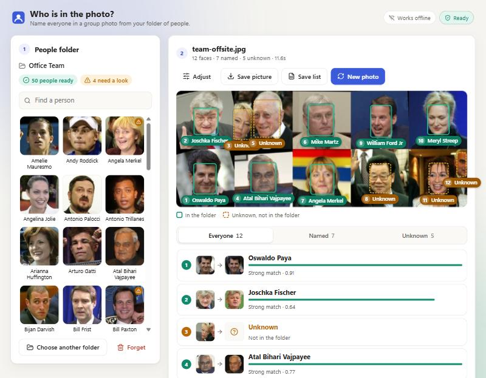
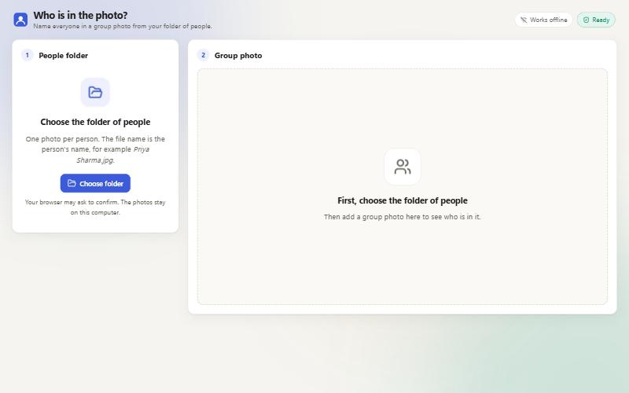
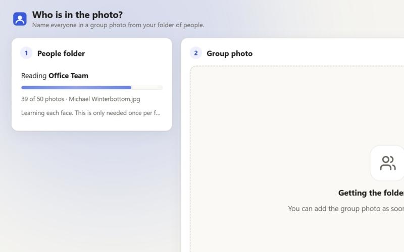
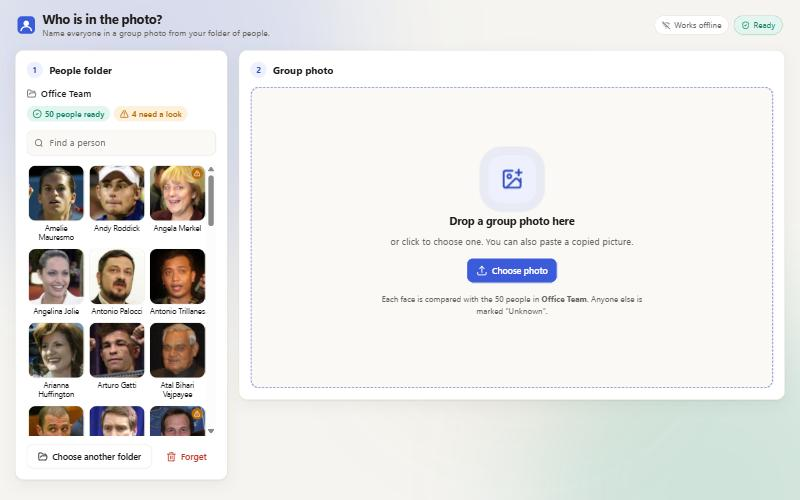
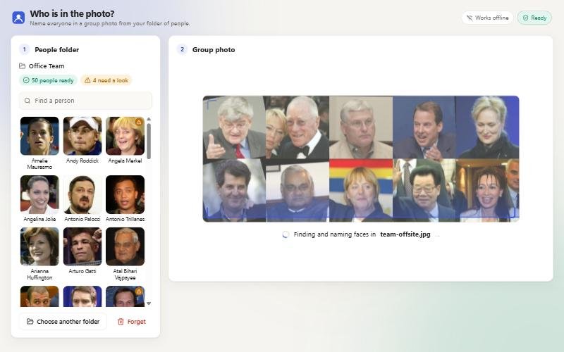
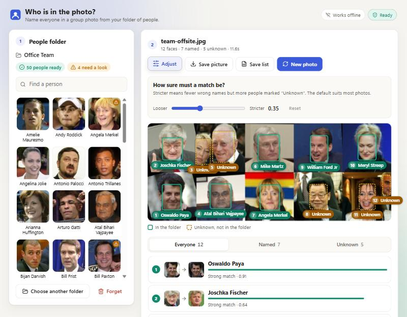
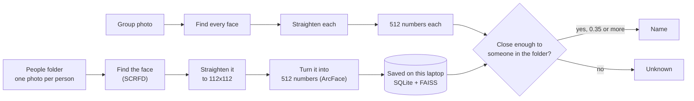
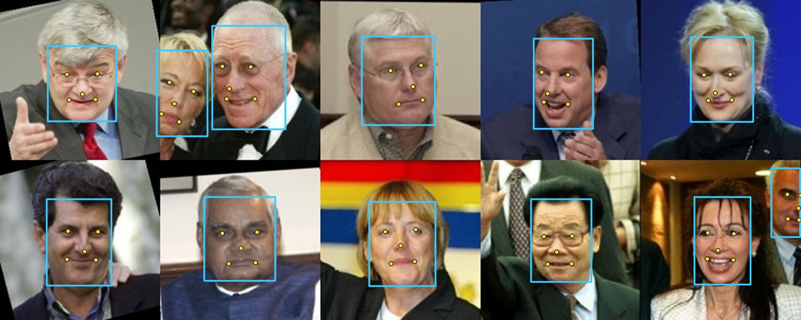
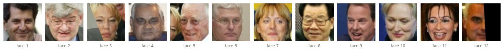
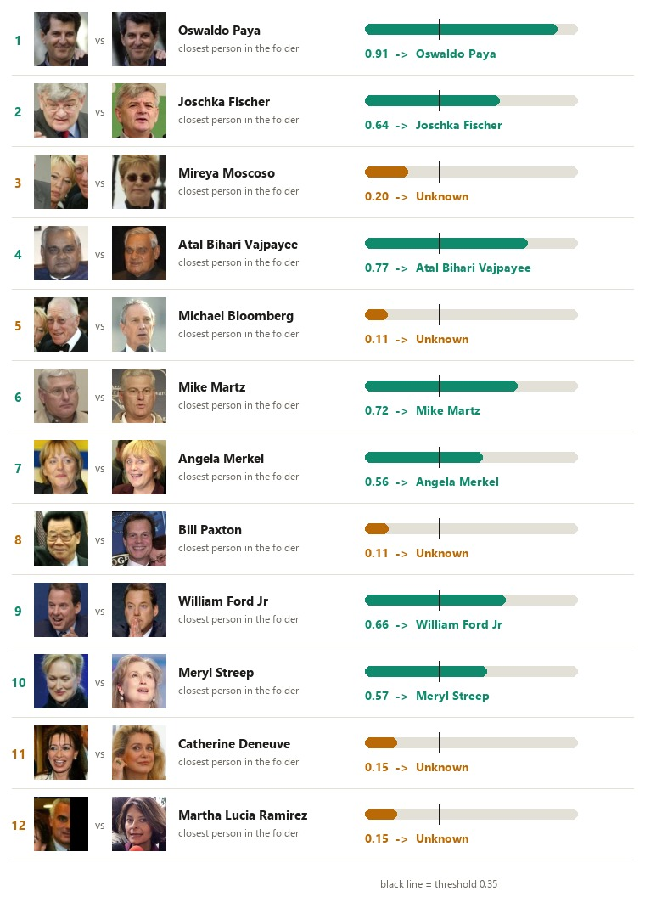

# Who is in the photo?

Open a folder of people, add a group photo, and see everyone's name on the
picture. Anyone who is not in the folder is marked **Unknown**.

Runs entirely on your own laptop. No internet, no cloud services, no accounts.



**Documents:** [ARCHITECTURE.md](ARCHITECTURE.md) · [RESEARCH.md](RESEARCH.md) · [AI_COLLAB.md](AI_COLLAB.md)

## What it does

1. **Choose the people folder.** One photo per person; the file name is the
   person's name (`Priya Sharma.jpg`).
2. **Add a group photo.** Drag it in, browse for it, or paste it.
3. **See who is who.** Names are drawn on the photo and listed beside it, each
   with the folder photo it was matched to. You can save the labelled picture
   and the list (CSV).

## A walk through the screen

The photos in these screenshots are practice data from the public LFW dataset.

| Step | What you see |
|---|---|
| **1. Start.** One screen, two steps. The second step stays locked until a folder is chosen. |  |
| **2. Choose the folder.** Each photo is read once; progress shows the current file. |  |
| **3. Folder ready.** Everyone found is shown with their name. Photos that need a look (no face, or several faces) are counted and listed. |  |
| **4. Add the group photo.** A scan runs over the photo while faces are found and named. |  |
| **5. Results.** Green boxes are people from the folder; dashed amber boxes are Unknown. Each list row pairs the face with the folder photo it matched and shows how strong the match is. |  |
| **6. Adjust (optional).** One slider for how sure a match must be. Names update instantly. |  |

## How it works



The same three steps run on every photo. These figures are real output from
the app's pipeline (`scripts/make_readme_figures.py`):

**1. Detect.** SCRFD finds each face and five landmarks (eyes, nose, mouth
corners), including small background faces.



**2. Align.** Each face is rotated and scaled so the landmarks sit in the same
place, which is what makes faces comparable.



**3. Embed and match.** ArcFace turns each aligned face into 512 numbers. Faces
of the same person give similar numbers. Each face is compared with everyone in
the folder; it gets a name only if the similarity reaches the threshold, and a
person can be used only once per photo.



Details and trade-offs are in [ARCHITECTURE.md](ARCHITECTURE.md).

## Install (once, needs internet)

You need:

- [uv](https://docs.astral.sh/uv/getting-started/installation/) (it installs Python 3.11 for you)
- [Node.js](https://nodejs.org/) 18 or newer (only to build the UI)

Then, on Windows, double-click **`setup.bat`**. Or run the three steps yourself
from the project folder:

```bash
# 1. Python packages
cd backend
uv sync --python 3.11
cd ..

# 2. Face models, about 280 MB download, saved to models/
uv run --project backend python scripts/download_models.py

# 3. Build the user interface
cd frontend
npm install
npm run build
cd ..
```

After this the app never needs the internet again.

## Run

On Windows, double-click **`start.bat`**. Or:

```bash
cd backend
uv run python run.py
```

Your browser opens at <http://127.0.0.1:8000>. Close the terminal window to
stop the app.

## Using it

- **Folder:** click *Choose folder* and pick the folder of people. The browser
  asks you to confirm; the photos are only read by the app on this computer.
  Enrolment takes roughly half a second per photo the first time and is
  instant when the same photos are opened again.
- **Photos that need a look:** if a reference photo has no visible face, or
  several faces, the folder panel says so and lists the files.
- **Group photo:** JPG, PNG, WEBP, BMP, TIFF and HEIC work. Phone photos are
  rotated the right way up automatically.
- **Adjust:** the *Adjust* button has one slider for how sure a match must be.
  The default (0.35) was chosen by measurement; see below.
- **Forget:** removes the stored faces and results from the app's data folder.

## Check accuracy yourself (optional)

```bash
uv run --project backend python scripts/make_practice_data.py   # builds practice_data/ from the public LFW dataset
uv run --project backend python scripts/evaluate.py             # prints accuracy at several thresholds
cd backend && uv run pytest                                     # unit tests for the matching rules
```

On the practice set (50 enrolled people, 12 collages of 10 faces, 3 strangers
in each) the default threshold named 84 of 84 enrolled faces correctly and
marked all 36 strangers as Unknown. With faults applied on purpose (blur, heavy
JPEG compression, noise) 77 to 81 of the 84 were still named, the rest became
Unknown, and nobody was given a wrong name. LFW is a fairly easy dataset, so
treat this as a sanity check, not a guarantee for every real photo. Full
numbers are in [RESEARCH.md](RESEARCH.md).

## Project layout

```
backend/app/
  detector.py   SCRFD face detector (ONNX Runtime)
  embedder.py   ArcFace alignment + 512-d embedding (ONNX Runtime)
  engine.py     detect -> align -> embed for reference and group photos
  matching.py   threshold + one-to-one name assignment (open-set)
  storage.py    SQLite (people, cache, results) + FAISS (vector search)
  main.py       FastAPI endpoints; also serves the built UI
frontend/src/   React + TypeScript UI
scripts/        model download, practice data, evaluation
models/         ONNX model files (downloaded, not in Git)
data/           SQLite database, FAISS index, uploads (created at runtime, not in Git)
```

## Security

The app is local, but another web page open in the same browser could still try
to call a local server. Every request passes through one gateway
(`backend/app/security.py`) before it reaches an endpoint:

| Protection | What it stops |
|---|---|
| Listens on `127.0.0.1` only | Access from other machines on the network |
| Host header allow-list | DNS-rebinding attacks |
| Origin and `Sec-Fetch-Site` checks, no CORS | Other websites calling the API |
| Session cookie (HttpOnly, SameSite=Strict, new on every launch) | Unauthenticated access to faces and names |
| CSRF token header on every change | Forged requests that create, delete or upload |
| Size, file-type and file-name checks on uploads | Oversized files, non-images, path tricks |
| Rate limits and an inference concurrency cap | Flooding the CPU-heavy endpoints |
| Content-Security-Policy, no framing, no sniffing, `no-store` on API data | Script injection, clickjacking, cached face data |
| API docs and schema endpoints disabled | Exploring the API from outside the UI |

Limits of this model: traffic is plain HTTP on the loopback interface (it never
leaves the machine), and another program running as the same Windows user can
read the app's `data/` folder directly. Both are outside what a local web app
can defend.

Developing the UI with `npm run dev` needs `FACEID_DEV=1` set for the backend,
which additionally allows the Vite dev server on port 5173.

## Notes

- The pretrained InsightFace models (`buffalo_l`) are released for
  non-commercial research use.
- The full AI chat history is in `docs/chat-history/`.
